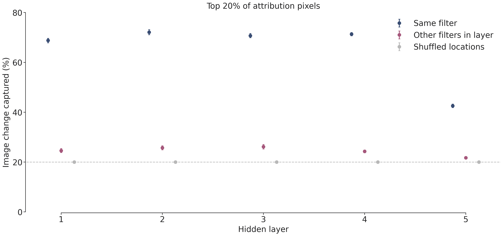
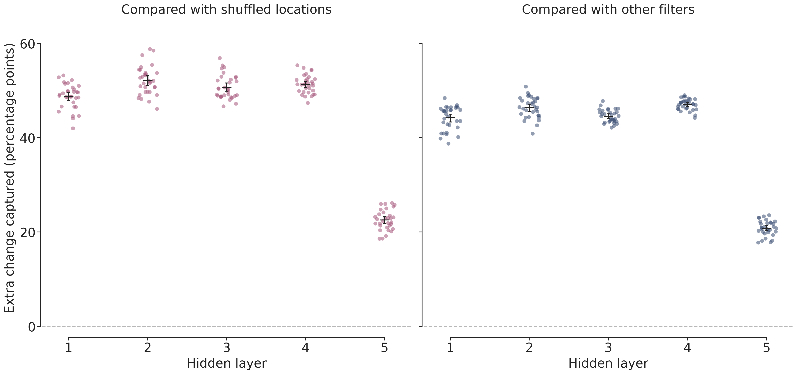
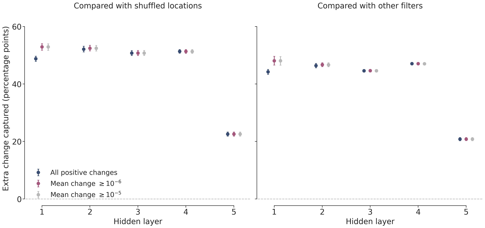
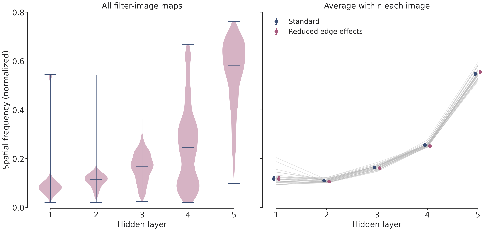
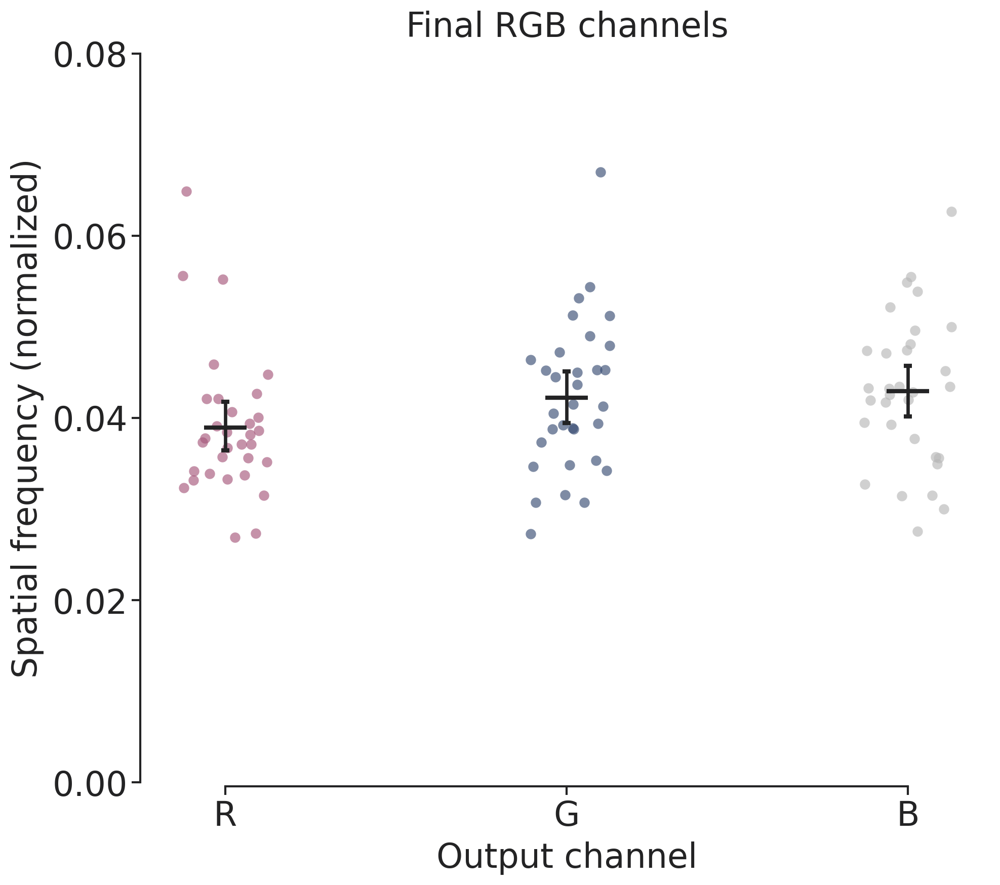
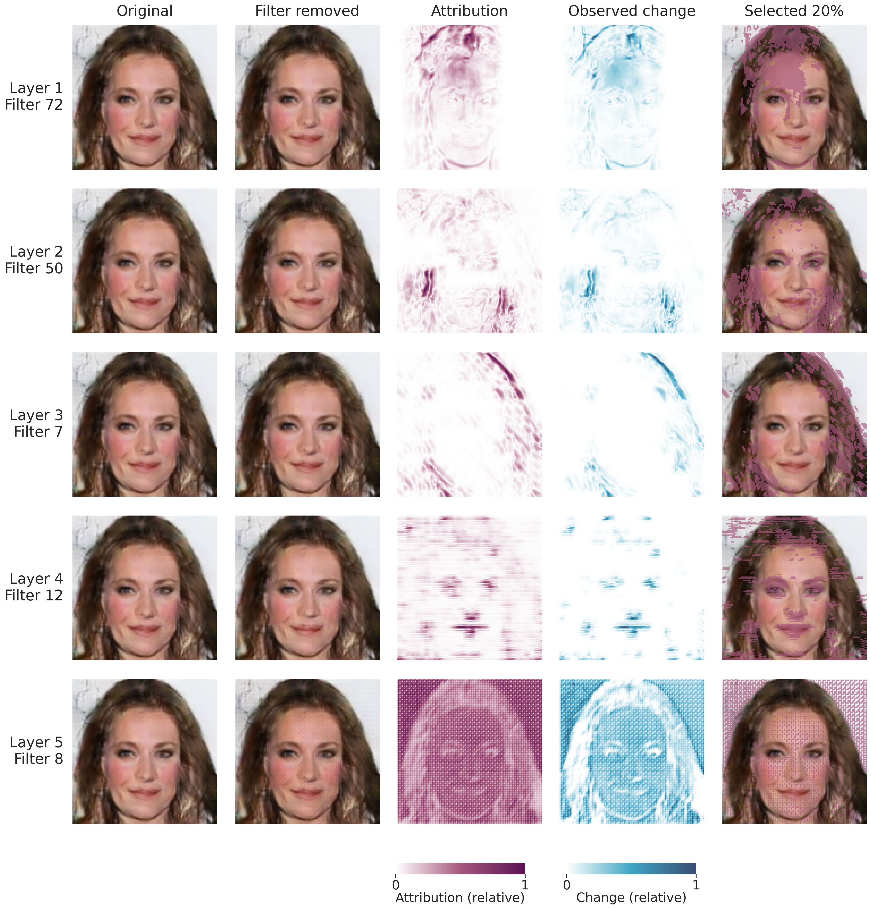

# DCGAN results: where filters matter and how their effects change

Plain-language findings with complete technical methods | Larger CelebA model

## 1. Does a filter's map point to where the image actually changes?

A filter is one internal channel in the generator. Its Shapley Mode is a map of its contribution to the output image, averaged over many combinations of active filters. Here we ask whether that map helps predict where the image changes when we switch off that filter on its own.

How the test works. Mark the 20% of image pixels with the strongest attribution. Remove the filter, measure how much every pixel changes, and ask how much of the total change falls in the marked area. A score of 70% means that 70% of the change magnitude is concentrated in just 20% of the image. It does not mean that 70% of pixels changed.

Figure 1. Higher means better localization. Navy: the correct filter's map. Purple: other filters' maps from the same layer. Grey: randomly shuffled locations, which capture about 20% by chance. Small bars show uncertainty across the 32 images. Layers are numbered 1-5 from earliest to latest throughout these figures.

What we found. The correct maps capture 42.6%-72.1% of the total change, despite marking only 20% of the image. They outperform both comparisons in every layer. The last hidden layer has lower agreement than the others, but still captures roughly twice the shuffled expectation. The maps therefore contain information specific to the affected filter, beyond general spatial biases shared by a layer.

| Hidden layer | Correct map | Other filters' maps |
|---|---|---|
| 1 | 68.8% | 24.6% |
| 2 | 72.1% | 25.7% |
| 3 | 70.7% | 26.1% |
| 4 | 71.3% | 24.3% |
| 5 | 42.6% | 21.7% |

Read pages 1-4 for the explanation and all six figures. Pages 5-6 retain the precise definitions, uncertainty calculations, numerical checks, and reproducibility details.

## 2. Does this result hold across images and tiny numerical changes?

Across images. The plots below show one dot for each of the 32 generated images, after averaging over filters in that layer. A value of zero means no improvement over the comparison. For example, capturing 70% instead of 25% is an improvement of 45 percentage points. Black marks show the average and its 95% confidence interval. Every layer's average improvement has an interval above zero for both comparisons.

Figure 2. Dots show image-level improvements. Left: improvement over shuffled locations. Right: improvement over other filters' maps. The vertical axis is in percentage points, not relative percent increases. The black marks summarize images; filters and pixels are not treated as independent experiments.

Could computer rounding explain the result? Repeating exactly the same model calculation can produce extremely small numerical differences. We therefore repeated the comparison after excluding cases with almost no image change. The main conclusion held at both exclusion thresholds. The earliest layer's agreement became stronger after these cases were removed.

Figure 3. Navy includes every positive image change. Purple and grey remove increasingly tiny changes (mean absolute pixel change below one millionth or one hundred-thousandth of the raw output range). Improvements remain positive. These cutoffs check numerical stability; they do not define a perceptually visible effect.

## 3. Do later filters contribute finer spatial patterns?

Spatial frequency describes how quickly a pattern changes from pixel to pixel. A broad, smooth patch has low frequency; fine texture, stripes, or a checkerboard has higher frequency. We summarize each signed Shapley Mode with one frequency score, technically called a normalized spectral centroid. A larger value means finer variation, not a more important filter or a particular facial feature.

Figure 4. Left: the distribution of frequency scores across every hidden filter and image; wider sections contain more maps. Right: averages for individual images (grey lines) and overall averages with uncertainty bars. Purple reduces the influence of the image edges using a Hann window. This check gives the same broad pattern.

What we found. Layer averages are 0.118, 0.110, 0.164, 0.256, 0.548. Later layers contain much finer variation overall. However, there is a small dip from layer 1 to layer 2, and only 15/32 images increase at every step. It is accurate to describe an overall shift towards finer patterns, rather than a perfectly ordered coarse-to-fine progression.

Figure 5. Final output channels are kept separate. Their mean frequency scores are R=0.039, G=0.042, and B=0.043. Dots represent images; black marks show means and 95% intervals. These channels are not another hidden layer and are excluded from the trend above.

## 4. A clearer example: what should I look for?

Read each row from left to right. The first two columns show the same image before and after removing one filter; subtle changes are easier to see in the heatmaps. Purple shows where the attribution is strongest, and blue shows where pixels actually changed most. The final column tints the 20% of pixels chosen by the attribution. Agreement means that the blue changes tend to fall in those selected locations.

Figure 6. Replacement example: saved image 30 and filters 72, 50, 7, 12, and 8 in successive hidden layers. The image and candidate filters come from the pre-existing DCGAN notebook. One filter per layer was selected for visible spatial structure, without selecting by agreement score. These are illustrations, not a representative sample. Heatmaps are scaled separately to their own maxima for display only; purple tint shows the exact selected pixels.

What this does and does not show. These maps help localize a filter's effect, and later layers tend to contain finer variation. The analysis does not show that filters represent named facial features. Some fine structure may be texture or checkerboard patterns. All numerical results still use every saved image and every hidden filter.

## Technical appendix A: dataset, spatial score, and uncertainty

Dataset and intervention. One historical, signed, unnormalized set of modes covers 32 fixed latent vectors, 128 x 128 RGB outputs, and 1,987 players: hidden widths 1,024/512/256/128/64 plus three output RGB channels. There are 63,488 hidden filter-image cases and 96 output-channel cases. The original Shapley game includes both hidden and output units, so output-channel gating is part of the coalition context. The notebook specifies 3,000 historical permutations, but this count is not stored in the averaged pickle. No new Shapley estimates were mixed in.

For image i, filter u, RGB channel c, and pixel p, let phi be the signed mode, G the intact generator output, and G with superscript (-u) its single-filter lesion. The generator is in evaluation mode. Lesions zero the selected output channel after the full ConvTranspose2d/BatchNorm/ReLU block; the final RGB block uses Sigmoid. Checkpoint, latent vectors, and zeroing convention match the historical objective.

$$
A_{ui}(p)=\frac{1}{3}\sum_c |\phi_{uic}(p)|,\qquad D_{ui}(p)=\frac{1}{3}\sum_c|G_c(z_i)(p)-G_c^{(-u)}(z_i)(p)|
$$

$$
S_{ui}=\frac{\sum_p M_{ui}(p)D_{ui}(p)}{\sum_p D_{ui}(p)},\qquad |M_{ui}|=\lceil 0.2\times128^2\rceil=3277
$$

The mask M contains the strongest attribution magnitudes, with seeded random tie-breaking. Its actual area is 20.00122070%. Controls are 100 uniform spatial permutations per map, with exact expected capture 3277/16384, and the exact average capture using every other eligible filter's mask from the same image and layer. Summed masks implement the latter without sampling pairs. All-zero attribution maps are ineligible reference masks.

Undefined and small effects. Exactly zero total change or all-zero attribution makes target agreement undefined; observed counts were 0 and 0. The primary analysis retains 2,718 positive effects with mean absolute change below 0.000001. Sensitivity thresholds are 0, 0.000001, and 0.00001 in raw [0,1] output units. Only target inclusion changes; reference masks are unchanged.

Aggregation and intervals. Valid filters are averaged equally within each image/layer; images are then averaged equally. The 95% percentile intervals use 10,000 image-bootstrap resamples. Gains are paired differences within each image, before resampling. The following table reports capture in percent and gains in percentage points, with 95% intervals.

| Layer | Capture (%) | Gain vs shuffle (pp) | Gain vs other maps (pp) |
|---|---|---|---|
| 1 | 68.8 [67.9, 69.7] | 48.8 [47.9, 49.7] | 44.2 [43.3, 45.1] |
| 2 | 72.1 [71.1, 73.2] | 52.1 [51.1, 53.2] | 46.4 [45.6, 47.2] |
| 3 | 70.7 [69.9, 71.6] | 50.7 [49.9, 51.6] | 44.6 [44.2, 45.1] |
| 4 | 71.3 [70.7, 72.0] | 51.3 [50.7, 52.0] | 47.1 [46.7, 47.5] |
| 5 | 42.6 [41.8, 43.3] | 22.6 [21.8, 23.3] | 20.8 [20.3, 21.4] |

Interpretation. Shapley Modes average effects over coalitions, whereas the lesion here starts from the fully intact generator. Perfect equality is not required. The other-filter comparison addresses spatial biases common to a layer. No per-filter significance claims or multiple-comparison p-value claims are made.

## Technical appendix B: frequency definition and reproducibility

Each signed RGB channel is demeaned separately over spatial positions before the full two-dimensional FFT. Channel powers are summed, not signed channels, so opposite RGB signs cannot cancel. DC power is explicitly zeroed. Frequencies fx and fy are in cycles/pixel, and both sides of the full spectrum are counted.

$$
\widetilde{\phi}_c=\phi_c-\operatorname{mean}_p\phi_c,\quad P(f)=\sum_c|\mathcal{F}(\widetilde{\phi}_c)(f)|^2,\quad P(0)=0
$$

$$
C=\frac{\sum_f \sqrt{f_x^2+f_y^2}\,P(f)}{\sqrt{0.5^2+0.5^2}\sum_fP(f)}
$$

Normalization uses the two-dimensional Nyquist corner, giving a score from 0 to 1; high values mean fine spatial variation. Non-DC energy is sum(P)/(H x W), using Parseval scaling. Exact zero energy receives NaN and is excluded; no hidden or output cases had zero energy. The primary calculation has no taper. A separable Hann window is applied after demeaning in the sensitivity analysis, and its DC power is also removed. Final RGB modes are analyzed separately.

| Layer | Standard centroid [95% CI] | Hann centroid [95% CI] |
|---|---|---|
| 1 | 0.118 [0.110, 0.127] | 0.116 [0.108, 0.126] |
| 2 | 0.110 [0.108, 0.112] | 0.106 [0.104, 0.108] |
| 3 | 0.164 [0.161, 0.167] | 0.161 [0.158, 0.164] |
| 4 | 0.256 [0.254, 0.258] | 0.251 [0.248, 0.255] |
| 5 | 0.548 [0.542, 0.555] | 0.555 [0.548, 0.562] |

Layer trends. The mean within-image last-minus-first difference is 0.4307 [0.4239, 0.4376]. The mean image-wise Spearman layer/frequency correlation is 0.9344 [0.9063, 0.9594]; these are descriptive trends, not evidence for facial semantics. Image-bootstrap intervals use within-image filter means as above.

Compatibility and precision. Summed modes reconstruct intact minus fully lesioned outputs with maximum absolute residual 1.19e-07 and mean residual 2.41e-09. All 32 image/latent indices match, fully lesioned output is zero, and repeated intact inference differs by at most 1.19e-07. Historical cuDNN/TF32 defaults are retained (benchmark off; deterministic off; cuDNN TF32 on; matrix-multiply TF32 off). Inference is float32; modes, metric reductions, and CUDA shuffle reductions use float64. Seed is 2810; batch size is 32. The CUDA shuffle implementation matches its CPU reference within 5.56e-16 on the recorded real-size validation.

Reproduction. From DCGAN, run plot_quantification.py. Then run build_illustrated_report.py inside quantification to recreate this presentation from saved results. The original analysis commands are in ../README.md. manifest.json records artifact SHA-256 values, versions, checkpoint, latents, and perturbations; unit_mapping.csv and latent_vectors.csv record ordered units and inputs. Figure layers 1-5 correspond to CSV layers 0-4; filter and image indices remain zero-based. figure_manifest.json and qualitative_examples.json record styling and example selection. PDF/SVG figures have editable text; PNGs are exported at 600 dpi. Display normalization of example heatmaps never enters the scientific measurements.

Limits. This is one checkpoint and one fixed sample of 32 images. Intervals do not include training-seed variation or uncertainty in historical Shapley estimates. Old input hashes were not stored, so compatibility rests on reconstruction and mapping checks. Frequency results depend on power weighting, resolution, and boundaries; the Hann analysis probes one boundary choice. No manual semantic annotation is used.
