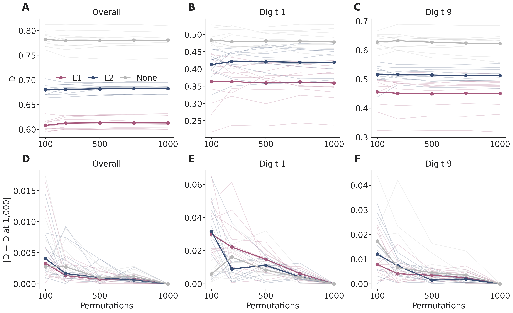
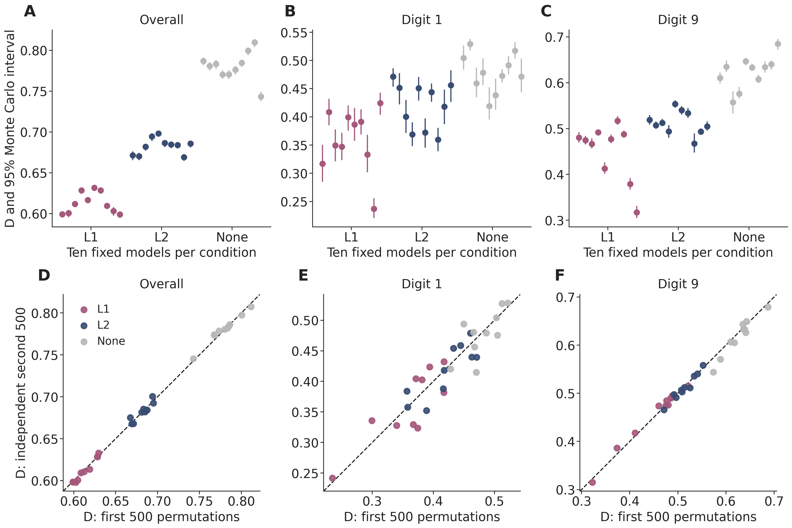
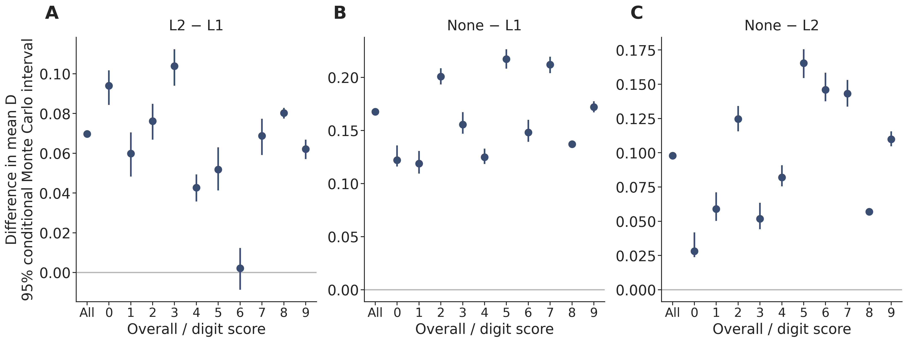
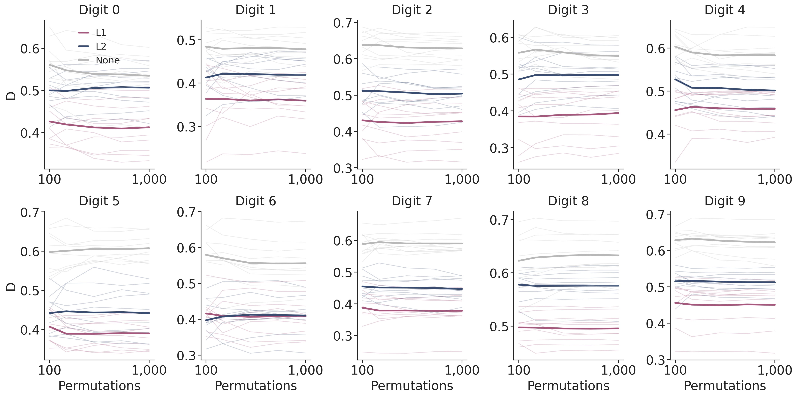

# MLP sampling stability of D

200-neuron stability check | 30 fixed checkpoints | 1,000 permutations per model

## 1. What is being checked?

D describes how broadly contributions are spread across hidden neurons. A value near 1 means that squared contributions are spread fairly evenly; a lower value means that fewer neurons dominate. Positive and negative contributions both enter through their squares. This experiment asks how much the estimated D changes when we sample different neuron-removal orders for the same trained network.

We use the ten existing 200-neuron checkpoints in each condition: L1, L2 and unregularized (None). Every checkpoint and every coalition uses the same saved, shuffled batch of 1,024 MNIST test images. Only the permutation samples vary. The original zero-output intervention and D formula are retained; no models are retrained. The final 1,000-permutation estimate is a finite-sample reference, not ground truth.

Figure 1. Top: D as the permutation budget increases. Thin lines show individual models and thick lines show condition means. Bottom: absolute differences from each model's 1,000-permutation reference; thick lines show the median difference within a condition. The final difference is zero by construction. Nested estimates share permutations, so this figure alone cannot establish convergence to the exact Shapley value.

At 500 permutations, the median absolute difference from the overall-D reference is L1: 0.0007, L2: 0.0010, None: 0.0010. At 1,000, overall mean D is 0.6129 for L1, 0.6826 for L2 and 0.7805 without regularization. These overall condition gaps are clearly larger than permutation uncertainty for these fixed models. Digit-wise estimates are less precise, as the next page shows.

Scoring detail. The original evaluation reverses the arguments to the classwise scorer, so its digit scores are precision values. We preserve this implementation. Overall D is computed from contributions averaged across those ten scores; it is not D for ordinary pooled test accuracy.

## 2. How uncertain is each model's D?

For each model, we bootstrap entire permutation vectors and recompute both Shapley contributions and D. Each interval describes Monte Carlo uncertainty conditional on that checkpoint and this image batch. The two 500-permutation halves contain independent removal orders; agreement near the dashed line provides a separate check on reproducibility at that smaller budget.

Figure 2. Top: one point per checkpoint at 1,000 permutations, with its 95% whole-permutation percentile interval. Conditions are grouped from left to right; checkpoint indices do not imply pairing between conditions. Bottom: first versus independent second 500-permutation estimates. Each dot is a trained model. The dashed line denotes exact agreement.

| Condition | Score | Mean D | Between-model SD | Median MC width |
|---|---|---|---|---|
| L1 | Overall | 0.6129 | 0.0129 | 0.0075 |
| L2 | Overall | 0.6826 | 0.0098 | 0.0083 |
| None | Overall | 0.7805 | 0.0179 | 0.0103 |
| L1 | Digit 1 | 0.3593 | 0.0554 | 0.0476 |
| L2 | Digit 1 | 0.4192 | 0.0413 | 0.0470 |
| None | Digit 1 | 0.4782 | 0.0342 | 0.0451 |
| L1 | Digit 9 | 0.4504 | 0.0617 | 0.0203 |
| L2 | Digit 9 | 0.5125 | 0.0253 | 0.0188 |
| None | Digit 9 | 0.6224 | 0.0364 | 0.0239 |

Across all 330 model-by-score estimates, 95% Monte Carlo interval widths range from 0.0060 to 0.0768. Between-model SD describes the spread of the ten checkpoint estimates. It is reported separately and is not an uncertainty bar obtained from permutation replicates. Digit 1 has wider intervals and larger independent-half differences than digit 9 in each condition.

## 3. Are condition differences larger than sampling uncertainty?

We compare condition means while keeping all ten checkpoints per condition fixed. Each bootstrap draw combines independent permutation resamples within those models. The resulting interval measures uncertainty from estimating contributions; it does not include training variability or uncertainty about a population of possible trained models.

Figure 3. Differences between condition means for overall D and every digit. Bars are 95% conditional Monte Carlo intervals. A positive value means the first condition has higher D. Intervals do not resample models or images. These are descriptive comparisons, with no multiplicity-adjusted population hypothesis tests.

| Comparison | Score | Difference | 95% conditional MC interval |
|---|---|---|---|
| L2 minus L1 | Overall | 0.0697 | [0.0678, 0.0714] |
| None minus L1 | Overall | 0.1676 | [0.1657, 0.1697] |
| None minus L2 | Overall | 0.0979 | [0.0961, 0.1002] |
| L2 minus L1 | Digit 1 | 0.0598 | [0.0483, 0.0705] |
| None minus L1 | Digit 1 | 0.1188 | [0.1093, 0.1307] |
| None minus L2 | Digit 1 | 0.0590 | [0.0503, 0.0712] |
| L2 minus L1 | Digit 9 | 0.0621 | [0.0570, 0.0669] |
| None minus L1 | Digit 9 | 0.1720 | [0.1670, 0.1774] |
| None minus L2 | Digit 9 | 0.1099 | [0.1048, 0.1156] |

Across all eleven scores and three comparisons, 32/33 conditional intervals exclude zero. The exception is L2 versus L1 for digit 6: the difference is 0.0021 with interval [-0.0087, 0.0123], so this small contrast is unresolved at this budget. The CSV also reports individual-model interval width relative to each absolute condition gap; a ratio above 1 means that a typical individual interval is wider than that condition difference. Larger permutation budgets would not remove genuine variation between trained checkpoints.

Nonlinear-estimator caution. Recomputing D after resampling introduces plug-in bias: bootstrap mean minus point estimate ranges from -0.0019 to 0.0085; 0/330 point estimates lie outside their percentile intervals. Intervals are approximate Monte Carlo summaries, not a guarantee that 1,000 permutations recover the exact D. Both the bias and the independent-half differences are retained in the numerical outputs. The budget remains 1,000 for every model, as requested; no extra sampling is performed.

## 4. Results for every digit

Figure 4. All ten digit-score convergence curves. Thin lines are the ten fixed models in each condition; thick lines are their means. Each panel has its own vertical scale so that within-digit changes remain visible. Purple: L1; navy: L2; grey: unregularized.

| Score | L1: mean (SD) | L2: mean (SD) | None: mean (SD) |
|---|---|---|---|
| Overall | 0.6129 (0.0129) | 0.6826 (0.0098) | 0.7805 (0.0179) |
| 0 | 0.4124 (0.0586) | 0.5063 (0.0481) | 0.5345 (0.0524) |
| 1 | 0.3593 (0.0554) | 0.4192 (0.0413) | 0.4782 (0.0342) |
| 2 | 0.4279 (0.0661) | 0.5041 (0.0443) | 0.6287 (0.0312) |
| 3 | 0.3941 (0.0685) | 0.4979 (0.0516) | 0.5497 (0.0473) |
| 4 | 0.4586 (0.0412) | 0.5013 (0.0446) | 0.5834 (0.0365) |
| 5 | 0.3900 (0.0395) | 0.4418 (0.0628) | 0.6072 (0.0329) |
| 6 | 0.4078 (0.0552) | 0.4099 (0.0513) | 0.5559 (0.0623) |
| 7 | 0.3780 (0.0547) | 0.4468 (0.0344) | 0.5899 (0.0329) |
| 8 | 0.4956 (0.0274) | 0.5759 (0.0309) | 0.6327 (0.0423) |
| 9 | 0.4504 (0.0617) | 0.5125 (0.0253) | 0.6224 (0.0364) |

Parentheses report between-checkpoint sample SD, not Monte Carlo intervals. Every model-by-digit Monte Carlo interval, half-run comparison and budget estimate is available in the CSVs, including digits 1 and 9. The analysis is a 200-neuron stability check; it does not establish stability at other network widths, on other evaluation batches, or for other value functions.

## 5. Technical methods and reproducibility

Fixed game. Thirty existing MNISTNet checkpoints (trials 0-9 per condition) are evaluated without retraining in float32 on cuda:2, with TF32 matrix multiplication disabled. Images are flattened and divided by 255 as in the original code. The batch is sampled once without replacement from the 10,000 test images; batch seed 3151469048, master seed 2810. True digit counts for 0-9 are [93, 112, 117, 103, 98, 102, 101, 100, 89, 109]. Each hidden-neuron output is set to zero immediately after layer1, before LeakyReLU. The output bias remains active when all hidden neurons are removed.

Preserved score. Let n_c be the number of images predicted as digit c and TP_c the correctly predicted images of that digit. The original argument order in evaluate_model makes the confusion-matrix row totals equal n_c, so the implemented score is:

$$
v_c(S)=\frac{\mathrm{TP}_c(S)}{n_c(S)+10^{-6}}.
$$

This is precision, with zero for an unpredicted digit. It is not recall or pooled accuracy. All ten digit scores are measured jointly for each coalition. For permutation r, remove neurons in the sampled order and record the drop in every digit score at each removal, assigning that vector to the removed neuron. This yields X with shape (1000, 200, 10) per model, stored in full. The orders use independent seeded NumPy PCG64 streams across models; there is no antithetic pairing. Prefixes 1:R define budgets 100, 250, 500, 750 and 1000; the halves are rows 1:500 and 501:1000.

$$
\widehat\phi_{i,c}^{(R)}=R^{-1}\sum_{r=1}^{R}X_{r,i,c},\qquad\widehat\phi_{i,\mathrm{overall}}=10^{-1}\sum_{c=0}^{9}\widehat\phi_{i,c}.
$$

$$
p_i=\frac{\widehat\phi_i^2}{\sum_j\widehat\phi_j^2},\qquad D=-\frac{\sum_{i=1}^{200}p_i\log p_i}{\log 200}.
$$

As in the original function, D=0 if all contributions are zero; exactly zero p entries become 1e-10 before taking logs, and D is clipped to [0,1]. Averaging contributions precedes squaring and entropy; we do not average digit-wise D to obtain overall D. Ratios with zero denominators are recorded as undefined, not replaced by finite values. Here there are 0 zero-energy mean vectors, 5,367,985 coalition-score entries with n_c=0 (handled by the original epsilon rule), and 0 undefined condition-gap ratios.

Bootstrap. For each model, 10,000 independent multinomial weight vectors resample 1,000 whole permutation rows with replacement. The same weights apply jointly to all 200 neurons and ten digit tasks. Recompute mean signed contributions, their overall average and then D; report the 2.5th and 97.5th percentiles and bootstrap SD. Neurons, tasks and models are not independent permutation replicates. Model-mean intervals average the ten independent within-model bootstrap draws without resampling models. Between-model SD uses ddof=1.

Numerical checks. Batched coalition evaluation precomputes intact hidden activations and applies the same zero masks and final affine layer. LeakyReLU(0)=0 makes this equivalent to the original intervention. Coalitions with a top-two logit margin below 1e-4 are re-evaluated through the original forward path (152,559 rechecks). All 128 validation coalitions per model exactly match the original sklearn-based score (3,840 coalitions, zero mismatches). The maximum permutation efficiency residual is 2.89e-15. Five known-answer statistical tests verify D, task averaging, score denominators, marginal assignment and joint resampling.

Artifacts. evaluation_batch.npz saves indices, images and labels; permutations_*.npz saves orders, marginal arrays, coalition correct/predicted counts and provenance. seeds.csv and manifest.json record model hashes and all seeds; analysis_manifest.json and figure_manifest.json record analysis settings, source and output hashes. CSVs separate model uncertainty, condition contrasts, checkpoint variation, contribution means/SEs and validation. Reproduce with run_sampling_stability.py, analyze_sampling_stability.py, plot_sampling_stability.py and sampling_stability/build_report.py, in that order; see README.md for commands.
